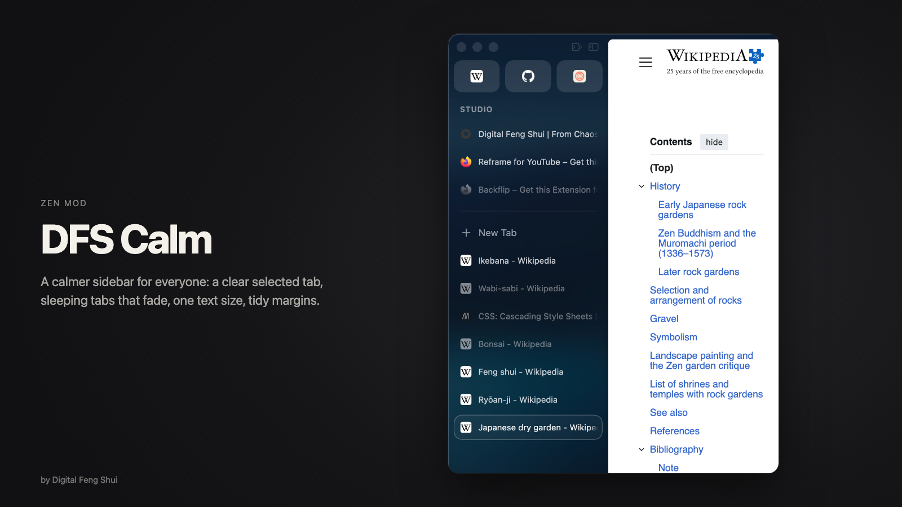
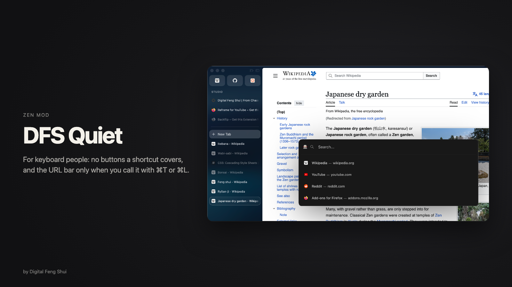
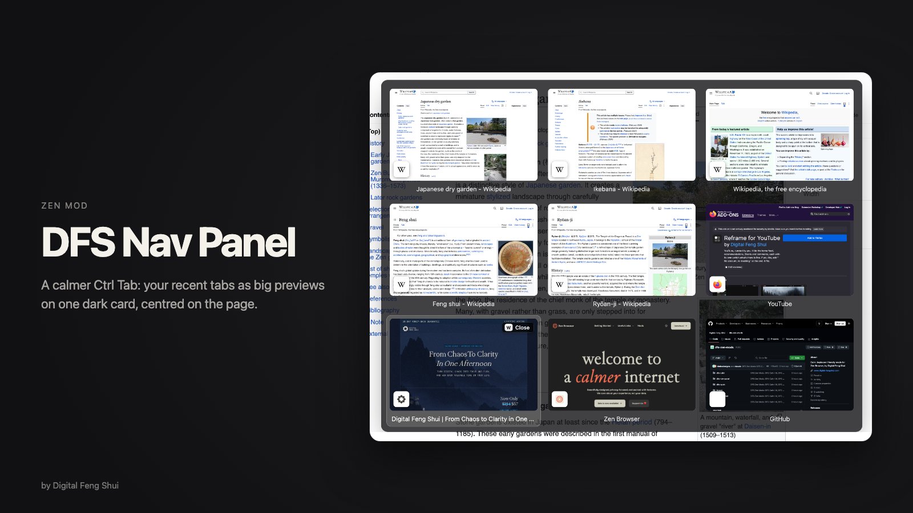

# DFS Zen Mods

Three mods for [Zen Browser](https://zen-browser.app), by [Digital Feng Shui](https://www.digital-fengshui.com). Plain CSS, no scripts.

| Mod | For | What it does |
| --- | --- | --- |
| [DFS Calm](dfs-calm) | Everyone | A calmer sidebar: a clear selected tab, sleeping tabs that fade, one text size, small buttons that wait until you hover, tidy margins, no link preview. |
| [DFS Quiet](dfs-quiet) | Keyboard people | Hides the buttons a shortcut covers (back, forward, reload and more) and keeps the URL bar row closed: ⌘T and ⌘L open it over the page. |
| [DFS Nav Panel](dfs-nav-panel) | Ctrl Tab users | Your recent tabs as big previews on one dark card, centred on the page. |

Start with DFS Calm. Add DFS Quiet once you know your shortcuts.

## Install
Zen's Import button only brings back mods from Zen's own store, so these install with a short script, [install.js](install.js). It hands Zen the three mods' GitHub links, and Zen downloads and turns them on itself.

1. In Zen, open `about:config`, search for `devtools.chrome.enabled` and set it to **true**.
2. Open the Browser Console: **⌘⇧J** on a Mac, **Ctrl+Shift+J** elsewhere (or Tools › Browser Tools › Browser Console).
3. Copy everything in [install.js](install.js), paste it into the line at the bottom of the console and press **Enter**. If the console asks, type `allow pasting` first.
4. The console answers with a line that starts with "Installed:" and names the three mods. All three are on. Each one has its own settings in **Settings › Mods** (the gear on its card); switch off any you don't want there.
5. You can set `devtools.chrome.enabled` back to false.

## Updates
Zen only updates mods from its own store by itself. To get the newest versions of these, run the same script again: it fetches the latest and keeps your settings.

---
© Digital Feng Shui. Licensed under [CC BY-NC-SA 4.0](LICENSE), the licence of Zen's mod store: use and change the mods freely, not for commercial use, credit Digital Feng Shui, and share changed versions under the same licence.
